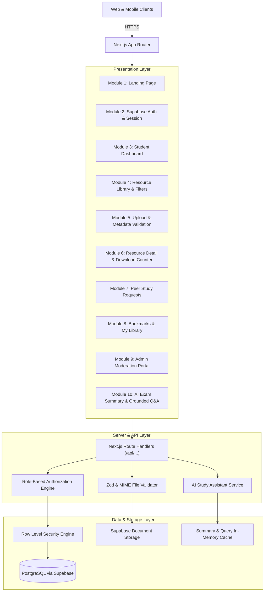

# EduShare Architecture and System Design Document

## 1. System Overview
**EduShare** is a centralized, digital learning and educational resource-sharing platform designed to eliminate the fragmentation of study notes, previous year question papers (PYQs), and laboratory manuals.

- **Tagline**: Learn Together. Share Knowledge. Grow Together.
- **Sub-theme**: Digital Learning and Educational Resource Accessibility.
- **Architectural Paradigm**: Modular Next.js 15 Full-Stack Application using App Router, TypeScript (Strict Mode), Tailwind CSS, Supabase (PostgreSQL + RLS + Auth + Storage), and Server-Side Grounded AI (Gemini 1.5).

---

## 2. Component Hierarchy & System Architecture

---

## 3. Core Modules Specification

### Module 1: Landing Page (`/`)
- Brand identity, tagline, problem & solution statement.
- Central search input with instant popular query chips ("DSA Notes", "OS PYQ 2025", "DBMS Normalization").
- Curated featured resources grid, 8-semester curriculum navigation, and 3-step platform workflow.
- Academic fair-use policy disclosure in footer.

### Module 2: Authentication & Roles (`/auth/login`, `/auth/register`)
- Supabase Auth integration with client and server session cookies.
- Three user roles:
  1. **Student**: Upload, download, bookmark, request, report, and query AI assistant.
  2. **Administrator**: Full moderation portal access, approve/reject submissions, resolve copyright reports, audit logs.
  3. **Guest**: Browse approved resources, search library, view document metadata.
- Pre-configured 1-click evaluator login buttons for immediate demonstration.

### Module 3: Student Dashboard (`/dashboard`)
- Status-tracking table for student uploads (`pending`, `approved`, `rejected` with moderator notes).
- Saved bookmarks and active personal study material requests.
- Semester-tailored recommendation feed.

### Module 4 & 11: Resource Library & Search (`/resources`)
- Full-text search matching titles, descriptions, and tags.
- Multi-dimensional filtering: Subject dropdown, 8 Semesters selector pills, Category selector, and Newest / Most Downloaded sorting.
- Responsive card view with file size, downloads count, and bookmarking.

### Module 5 & 6: Upload, Management & Detail (`/resources/[id]`)
- Multi-step modal validating document size (<=25MB), supported extensions (`.pdf`, `.docx`, `.pptx`, `.txt`), title, description, and academic fair-use consent.
- Submissions are queued in `pending` status.
- Secure downloads increment atomic counter and serve clean file streams.

### Module 7: Study Material Requests (`/requests`)
- Peer-to-peer request board for missing question papers or chapter notes.
- "Contribute Resource" workflow allowing peers to fulfill open requests.

### Module 8: Bookmarks & Library (`/bookmarks`)
- Persistent personal library with zero duplicate bookmark enforcement.

### Module 9: Admin Moderation Portal (`/admin`)
- Platform statistics: Total Students, Approved Resources, Pending Submissions, Reported Resources, Open Requests, Total Downloads.
- Pending submissions review queue: 1-click Approve or Reject with reason dialogue.
- Reported materials resolution queue (Dismiss report or Remove resource).
- Chronological moderation audit logs.

### Module 10: AI Study Assistant (Server-Side)
- **Document Summarization**: Extracts main concepts, key definitions, bullet points, and self-assessment practice questions with answer hints.
- **Grounded Q&A**: Answers questions strictly grounded in document text with source citations; explicitly rejects out-of-scope inquiries.
- **Safety**: Prompt injection isolation, input sanitization, stop-word filtering, and graceful offline fallback.
